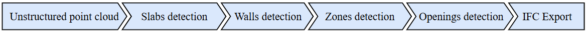

# Cloud2BIM


# Project Update & Advanced Version:
> This repository contains the foundational open-source research version of the Cloud2BIM algorithm. An advanced, production-ready version of this software, **Cloud2BIM-AI**, is now available through **Constriq** (a Czech Technical University spin-off). 
>
> While the open-source script provides core functionality, **Cloud2BIM-AI** is actively developed for commercial and enterprise workflows, offering the following expanded capabilities:
> * **Enhanced Element Recognition:** Advanced AI models capable of recognizing a wider variety of complex building elements with higher precision.
> * **Increased Robustness:** Fully automated processing that eliminates the need for manual parameter tuning.
> * **Optimized Performance:** Significantly reduced computational time for large-scale point cloud datasets.
> * **Continuous Support & GUI:** A user-friendly interface with visual verification and ongoing technical development.
>
> For professional deployment and access to the advanced version, please visit: **[constriq.tech](https://constriq.tech/)**

---

### Description
Cloud2BIM automates the Scan-to-BIM process by converting point clouds into 3D parametric entities. It employs a segmentation algorithm that utilizes point cloud density analysis, augmented by image and morphological operations. This allows the software to precisely extract the geometry of building elements such as slabs, walls, windows, and doors.

### Installation
To install Cloud2BIM, follow these steps:
git clone 

https://github.com/VaclavNezerka/Cloud2BIM.git

Install dependencies:

First, ensure you have Python and pip installed.
Then, install the required dependencies listed in the requirements.txt file:

pip install -r requirements.txt

# Running the Script
The `cloud2entities.py` script requires a YAML configuration file to run. You can provide the path to the 
configuration file as a command-line argument. If no argument is provided, the script will 
automatically use the default file `config.yaml`.

### Example command

python cloud2entities.py config.yaml

## Simple web interface

Start the local upload page from the project directory:

```bash
python app.py
```

Open [http://127.0.0.1:5000](http://127.0.0.1:5000), upload an `.e57` or `.las` scan, and download the generated IFC model and interior-candidate report. The web interface uses the settings in `config.yaml`, processes one scan at a time, and accepts uploads up to 10 GB. It is intended for local use only.

The upload limit is not a guarantee that a 10 GB scan can be reconstructed on a
given computer. The current pipeline expands LAS into a text XYZ file and loads the
full point cloud into memory; very large inputs can require much more than 10 GB of
free disk space and RAM and may exceed the processing timeout. Use smaller or
pre-tiled scans unless the machine has been provisioned and tested for the complete
dataset.

### Dataset
The complete original point cloud for Kladno station is available at Zenodo platform.

https://zenodo.org/records/14221915

## Citation

If you find this project or any part of it useful in your research or work, please consider citing the following article:

@article{Cloud2BIM_2025,
    title = {Open-source automatic pipeline for efficient conversion of large-scale point clouds to IFC format},
    journal = {Automation in Construction},
    volume = {177},
    pages = {106303},
    year = {2025},
    issn = {0926-5805},
    doi = {https://doi.org/10.1016/j.autcon.2025.106303},
    author = {Slávek Zbirovský and Václav Nežerka},
}

# License
MIT License


## Interior reconstruction extension (experimental)

The pipeline runs a geometry-based interior candidate stage after point-cloud import.
It adaptively voxelizes the scan while retaining representative source-point indices,
removes only building-scale planar supports, and clusters remaining geometry with
density-aware DBSCAN. It writes:

- `output_IFC/interior_analysis/interior_candidates.json` (or beside the configured IFC output)
- candidate bounding boxes, dimensions, centroids, point counts, source-point indices and review flags
- review-only `IfcBuildingElementProxy` bounding envelopes in the IFC, explicitly marked as
  inferred geometry candidates rather than verified furniture families
- a downloadable interior candidate report from the web interface

The web interface accepts `.e57` and `.las` scans. LAS coordinates must already be
in metres; no CRS or unit conversion is performed. LAS coordinates, RGB when present,
and intensity are written to the intermediate XYZ file; current IFC geometry uses XYZ
and RGB. Install the project dependencies, including `laspy`, with
`pip install -r requirements.txt`.

### Important accuracy and production notes

This extension is a candidate-discovery stage, **not** a completed semantic-to-BIM
reconstructor. The current repository's PTv3 research module reports synthetic held-out
segmentation metrics, but the inference implementation/checkpoint is not included in
this archive and the README itself notes that real-scan semantic performance is
unquantified. Therefore those synthetic metrics must not be represented as 95%+
real-world BIM accuracy.

To reach reliable object-level BIM, the next required stages are: (1) integrate a
deployable model trained on labelled real indoor scans (e.g. ScanNet/S3DIS plus
project-specific classes), (2) instance segmentation and object pose estimation,
(3) fit parametric Revit/IFC families to each instance, (4) retain a confidence and
source-point association per element, and (5) validate dimensions and surface
deviation against held-out scan points. Occluded objects should be marked inferred
or incomplete, not silently fabricated.

The IFC candidate envelopes are deliberately not labeled as chairs, tables, or other
specific objects. A deployable real-scan semantic model, room/instance segmentation,
parametric family fitting, and measured validation are still required for production
object reconstruction. The current pipeline's architectural stages continue to
generate slabs, walls, spaces, and detected openings; they do not infer missing or
occluded geometry.
